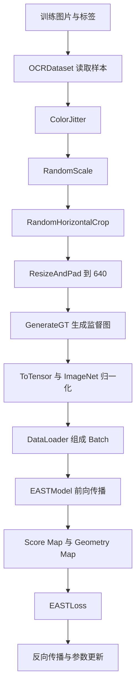
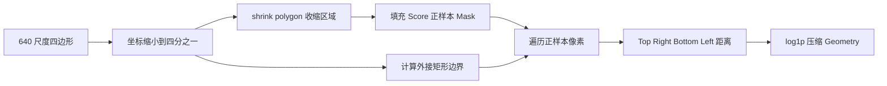
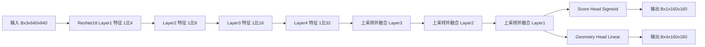
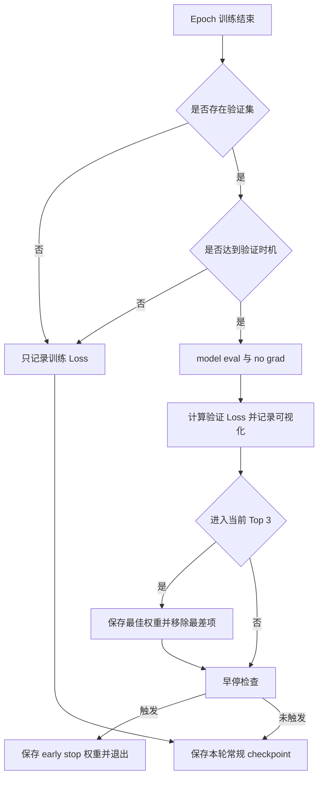

# Detection 文本检测训练流程

本文档依据当前代码梳理 `detection/train_resnet.py` 的实际训练过程，覆盖数据读取、增强、真值生成、EAST 前向传播、损失、验证、早停、TensorBoard 和 checkpoint 管理。文末的优化方案是后续建议，**尚未在当前训练代码中实现**。

## 1. 训练目标与代码入口

训练目标是从输入图像中定位文本区域。当前模型使用 ResNet18 提取多尺度特征，通过 FPN 风格的逐级上采样与融合，输出：

- `score map`：每个特征点属于文本区域的概率。
- `geometry map`：每个正样本点到文本框 `top/right/bottom/left` 四条边的距离。

主要入口和直接依赖如下。

| 文件 | 作用 |
| --- | --- |
| `detection/train_resnet.py` | 训练主循环、验证、早停、日志和模型保存 |
| `detection/components/dataset.py` | 图像与标签配对，解析矩形标注并转换为四边形 |
| `detection/components/transforms.py` | 数据增强、等比例缩放与 padding、真值生成、归一化 |
| `detection/components/ground_truth.py` | 生成 1/4 尺度的 score map 和 geometry map |
| `detection/models/east_model.py` | ResNet18 编码器、FPN 风格融合和两个输出 head |
| `detection/components/loss.py` | Dice 分类损失、masked Smooth L1 几何损失 |

从仓库根目录运行，且必须先激活项目虚拟环境：

```bash
source .venv/bin/activate
python detection/train_resnet.py
```

训练前应先确认数据目录存在。脚本只在入口处检查训练图片目录和训练标签目录；缺失时打印错误并不进入 `main()`。

## 2. 当前训练配置

训练参数全部定义在 `detection/train_resnet.py` 顶部，不使用命令行参数。

| 配置 | 当前值 | 作用 |
| --- | ---: | --- |
| `LEARNING_RATE` | `1e-4` | Adam 初始学习率；实际学习率由 OneCycleLR 逐 batch 调整 |
| `BATCH_SIZE` | `4` | 每个训练/验证 batch 的图片数 |
| `EPOCHS` | `620` | 最大训练轮数 |
| `INPUT_SIZE` | `640` | 图片最终输入尺寸为 `640 x 640` |
| `TRAIN_IMAGE_DIR` | `detection/data/train_images` | 训练图片目录 |
| `TRAIN_LABEL_DIR` | `detection/data/train_labels` | 训练标签目录 |
| `VAL_IMAGE_DIR` | `detection/data/val_images` | 验证图片目录 |
| `VAL_LABEL_DIR` | `detection/data/val_labels` | 验证标签目录 |
| `MAX_KEEP_CHECKPOINTS` | `100` | 当前进程内保留的最近常规 checkpoint 数 |
| `BEST_MODELS_TO_KEEP` | `3` | 按验证 loss 保留的最佳模型数 |
| `VAL_INTERVAL` | `10` | 稀疏验证阶段的 epoch 间隔 |
| `START_DENSE_VAL_EPOCH` | `50` | 从该 epoch 起每轮验证 |
| `EARLY_STOP_PATIENCE` | `100` | 连续 100 次验证未达到最小改善后早停 |
| `EARLY_STOP_MIN_DELTA` | `1e-5` | 判定验证 loss 改善的最小幅度 |

优化器和调度器的当前配置：

- 优化器：`Adam(model.parameters(), lr=1e-4, weight_decay=1e-4)`。
- 调度器：`OneCycleLR`，`max_lr=3e-4`、`pct_start=0.05`。
- 调度粒度：每个 batch 在 `optimizer.step()` 后执行一次 `scheduler.step()`。
- 梯度裁剪：全模型梯度 L2 范数最大为 `5.0`。

## 3. 数据目录与标签格式

期望目录结构：

```text
detection/data/
├── train_images/
│   └── sample.jpg
├── train_labels/
│   └── gt_sample.txt
├── val_images/
│   └── sample.jpg
└── val_labels/
    └── gt_sample.txt
```

`OCRDataset` 先查找目录中的 `*.jpg`；只有完全没有 JPG 时才改为查找 `*.png`。每张图片的标签文件按以下规则映射：

```text
<image_dir>/<stem>.<ext> -> <label_dir>/gt_<stem>.txt
```

当前每行标签按空白字符切分：

```text
x_min y_min x_max y_max [text]
```

前四个字段转换为整数坐标，再生成顺序固定的四边形：

```text
左上 -> 右上 -> 右下 -> 左下
```

处理规则：

- 少于四个字段、坐标无法转换或索引异常的行会被跳过并打印警告。
- 标签文件不存在时返回空四边形，后续会生成全零 score/geometry map。
- 第五个字段只作为可选文本读取；当前训练张量不使用 transcription。
- `###` 不加入 transcription，但对应四边形仍会进入 `quads`，因此它目前并未从检测监督中排除。

## 4. 端到端数据流



训练和验证的变换不同：

| 阶段 | 变换顺序 |
| --- | --- |
| 训练 | ColorJitter -> RandomScale -> RandomHorizontalCrop -> ResizeAndPad -> GenerateGT -> ToTensor |
| 验证 | ResizeAndPad -> GenerateGT -> ToTensor |

### 4.1 数据增强

1. `ColorJitterTransform`
   - 亮度、对比度、饱和度最大扰动 `0.3`，色相最大扰动 `0.1`。
   - 只修改图片，不修改四边形。
2. `RandomScale`
   - 从 `[0.8, 1.2]` 均匀采样缩放比例。
   - 同步缩放图片和全部四边形坐标。
   - 空标注样本直接跳过该增强。
3. `RandomHorizontalCrop`
   - 50% 概率跳过；执行时保留原宽度的 70% 到 100%。
   - 按四边形中心是否落在裁剪区内决定是否保留。
   - 保留框的横坐标裁剪到新图范围；如果没有任何框留下，则放弃本次裁剪。
4. `ResizeAndPad`
   - 保持宽高比缩放到 `640 x 640` 内。
   - 剩余区域用 RGB `(128,128,128)` 居中填充。
   - 四边形同步缩放并加上居中偏移。

### 4.2 Ground Truth 生成

`GenerateGT` 使用 `score_map_scale=0.25`，因此 640 输入对应 160 x 160 的监督图。



关键点：

- `shrink_polygon` 当前使用 `r=0.35`，并将收缩距离限制在最短边的 `45%` 以内。
- score map 的收缩区域置为 1，其余位置保持 0。
- geometry map 有四个通道，顺序是 `top/right/bottom/left`。
- 距离依据缩放后四边形的轴对齐外接矩形计算，并非旋转框距离。
- 如果多个框覆盖同一正样本点，保留面积较小的几何目标。
- 最后对几何距离执行 `np.log1p`，训练目标位于 log 空间。

### 4.3 DataLoader 输出

`ToTensor` 丢弃可变长度的 `quads` 和 `transcriptions`，只返回固定形状张量：

| 键 | 单样本形状 | Batch 形状 | 含义 |
| --- | --- | --- | --- |
| `image` | `[3,640,640]` | `[B,3,640,640]` | ImageNet 均值方差归一化图片 |
| `score_map` | `[160,160]` | `[B,160,160]` | 文本区域监督；训练时再 `unsqueeze(1)` |
| `geo_map` | `[4,160,160]` | `[B,4,160,160]` | log 空间的四边距离 |

训练 DataLoader 使用 `shuffle=True`、`num_workers=4`、`pin_memory=True`。验证 DataLoader 使用相同 batch size，但不打乱。

## 5. 模型结构与张量形状



当前 `EASTModel` 的执行过程：

1. 预训练 ResNet18 产生 1/4、1/8、1/16、1/32 四层特征。
2. 使用三次反卷积逐级上采样。
3. 与相同分辨率的编码器特征拼接，再经卷积、BatchNorm、ReLU 融合。
4. `score_conv` 经过 sigmoid，输出文本概率。
5. `geo_conv` 直接输出四通道值，没有 sigmoid、ReLU 或指数恢复。

## 6. 损失函数

总损失为：

```text
total_loss = score_loss + lambda_iou * geo_loss
lambda_iou = 3
```

尽管参数名为 `lambda_iou`，当前生效的几何损失不是 IoU，而是正样本区域内的 Smooth L1。

### 6.1 Score Loss

`DiceLoss` 将整批预测和真值展平：

```text
dice = (2 * intersection + smooth) / (pred_sum + target_sum + smooth)
score_loss = 1 - dice
```

其作用是缓解文本像素和背景像素的类别不平衡。

### 6.2 Geometry Loss

1. 使用 `y_true_score > 0` 得到正样本 mask。
2. 将 mask 扩展到四个 geometry 通道。
3. 只对 mask 区域的预测和真值计算 `smooth_l1_loss(reduction='sum')`。
4. 除以 `正样本像素数 * 4 + 1e-6`。

`iou_loss()` 和 `iou_loss_real()` 仍保留在文件中，但当前 `forward()` 没有调用它们。

## 7. 单个 Epoch 的训练过程

每个 epoch 执行以下顺序：

1. `model.train()`，清空三个 epoch 累计损失。
2. 从 DataLoader 读取 batch，并将图片、score map、geometry map 移到 CPU 或 CUDA 设备。
3. 对 score map 增加通道维，得到 `[B,1,160,160]`。
4. `optimizer.zero_grad()` 清空上一 batch 梯度。
5. `model(images)` 得到 score 和 geometry 预测。
6. `criterion(...)` 计算 total、score、geometry 三项损失。
7. `loss.backward()` 反向传播。
8. 每 100 个 batch 遍历全部参数，将梯度直方图和每个参数的梯度范数写入 TensorBoard。
9. `clip_grad_norm_(..., max_norm=5.0)` 裁剪梯度。
10. `optimizer.step()` 更新模型参数。
11. `scheduler.step()` 更新本 batch 的学习率。
12. 将 batch 损失写入 TensorBoard，并更新 tqdm 显示。
13. epoch 结束后计算平均 total、score、geometry loss，并记录当前学习率。

TensorBoard 的 batch `global_step` 当前使用 `epoch * len(train_loader) + batch_idx`，因此第一轮记录不是从 0 开始。

## 8. 验证、早停与模型保存



### 8.1 验证频率

- Epoch 1 到 49：仅在 epoch 能被 10 整除时验证。
- Epoch 50 起：每个 epoch 都验证。
- 只有验证图片目录、标签目录都存在且数据集非空时，`val_loader` 才会创建。

### 8.2 验证内容

`validate()` 使用 `model.eval()` 和 `torch.no_grad()`，累计三项 loss。第一个验证 batch 还会写入：

- 输入图片。
- 真实 score map。
- 预测 score map。
- 预测 geometry 的 top 通道归一化图。

当前验证只计算训练损失，没有计算检测 Precision、Recall、F1 或 IoU 匹配指标。

### 8.3 Top-K 最佳模型

验证 loss 能进入当前 Top-3 时，保存：

```text
detection/checkpoints/best_detection_epoch_<epoch>_loss_<val_loss>.pth
```

列表按 loss 从小到大排序，超过 3 个时删除当前列表中 loss 最大的文件。该列表只存在于当前 Python 进程内。

### 8.4 早停

`EarlyStopping` 保存历史最佳验证 loss。只有新 loss 小于 `best_loss - 1e-5` 才算改善并清零 counter；否则 counter 加 1。连续 100 次验证无改善后：

1. 保存 `detection_epoch_<epoch>_early_stop.pth`。
2. 退出 epoch 循环。
3. 输出最佳 epoch 和 loss。

类中还记录 `val_loss - train_loss`，最近 gap 明显扩大时打印过拟合警告，但该警告不直接停止训练。

### 8.5 常规 checkpoint

未触发早停时，每个 epoch 都保存：

```text
detection/checkpoints/detection_epoch_<epoch>.pth
```

当前进程内只保留最近 100 个。文件内容仅为 `model.state_dict()`，不含 optimizer、scheduler、当前 epoch、随机数状态和早停状态。

## 9. TensorBoard 观察点

日志目录：

```text
detection/runs/ocr_experiment_<timestamp>
```

启动查看：

```bash
tensorboard --logdir=detection/runs
```

建议重点观察：

- `batch/loss`、`batch/score_loss`、`batch/geo_loss` 是否稳定下降。
- `epoch/loss` 中 train/validation gap 是否持续扩大。
- 学习率是否按 OneCycle 先升后降。
- `Vis/True_Score_Map` 与 `Vis/Pred_Score_Map` 的位置和尺度是否一致。
- 梯度范数是否出现长期接近 0、突然爆炸或特定层异常。

## 10. 当前已知风险

以下是源码现状，不表示问题已经修复。

| 风险 | 当前行为 | 影响 |
| --- | --- | --- |
| Geometry 空间不完全明确 | ground truth 执行 `log1p`；模型 geometry head 无非负激活；损失注释称预测经过 ReLU | 训练、推理恢复和导出若采用不同假设，框尺度可能错误 |
| 无验证集的结束摘要 | `best_loss` 初始为 `None`，结束时使用 `.5f` 格式化 | 没有有效验证集时可能在训练结束阶段抛出异常 |
| 非有限 loss 未显式拦截 | 训练循环直接反向传播并更新参数 | NaN/Inf 可能污染权重和优化器状态 |
| Checkpoint 不可完整恢复 | 只保存模型权重 | 中断后无法无损恢复学习率周期、优化器动量和早停计数 |
| 常规模型清理只覆盖本次运行 | `regular_checkpoints` 启动时为空 | 重启训练不会识别并清理旧运行留下的 checkpoint |
| 裁剪框监督可能失真 | 只按中心保留框，再将横坐标 clip 到边界 | 被截断框可能产生不稳定或不符合任务定义的边界监督 |
| `###` 区域仍参与检测 | transcription 被忽略但 quad 已加入 | 原本期望的 ignore 区域会成为正样本 |
| 图片格式发现逻辑互斥 | 有任意 JPG 时不会再加载 PNG | 混合格式数据集可能漏样本 |
| 最佳模型只看 loss | 没有真实框级检测指标 | 最低 loss 不一定对应最佳 Precision/Recall/F1 |
| 日志开销较大 | 每 100 batch 遍历所有参数记录直方图 | 大模型或长训练时会增加 I/O 和训练耗时 |

## 11. 训练流程优化方案

以下方案均为建议，尚未实现。优先处理 P0，再用固定数据划分做 P1/P2 对照实验。

| 优先级 | 问题与修改位置 | 建议做法 | 验证指标 | 预期收益 |
| --- | --- | --- | --- | --- |
| P0 | Geometry 契约分散在 `ground_truth.py`、`east_model.py`、`loss.py` 和推理代码 | 明确统一为 log 距离或原始距离；若用 log 空间，模型输出采用与目标一致的约束，并在后处理集中执行 `expm1`；增加固定四边形的编码/恢复测试 | 编码后恢复误差、PyTorch/ONNX 框坐标误差、有限 loss 比例 | 避免训练正常但推理框尺度错误 |
| P0 | `train_resnet.py` 无验证集结束路径 | 仅在存在验证结果时格式化最佳 loss；无验证集时输出明确说明，并禁止 Top-K/早停逻辑 | 无验证集跑 1 个最小 epoch 能正常结束 | 消除结束阶段异常 |
| P0 | 训练循环未拦截 NaN/Inf | 在 `backward()` 前检查 `torch.isfinite(loss)`；异常时记录样本、loss 分量和输入范围，跳过该 batch 并设置连续异常上限 | 非有限 batch 数、异常样本可追踪率、权重保持有限 | 防止单个坏 batch 污染训练 |
| P0 | checkpoint 只有权重 | 保存 `epoch`、model、optimizer、scheduler、early stopping、best list、随机数状态和配置快照；加载时做版本与结构校验 | 中断前后下一 batch 学习率和 loss 一致 | 支持可靠断点续训 |
| P0 | ignore 区域与混合图片格式 | 让 dataset 同时收集 JPG/PNG；为 `###` 维护 ignore mask 或在生成 GT 前剔除对应 quad | 样本总数、ignore 区域 score mask、人工抽检 | 避免漏数据和错误正样本 |
| P1 | 最佳模型只按 val loss | 在固定验证集上调用框级评估，至少记录 Precision、Recall、F1；主选择指标使用 F1，loss 用于诊断 | F1、Precision、Recall、val loss | 模型选择更贴近最终检测效果 |
| P1 | 数据和 GT 缺少自动检查 | 为标签解析、ResizeAndPad、随机裁剪、polygon shrink、空标注和重叠框增加单元测试及可视化快照 | 测试通过率、随机抽样错误率 | 降低几何监督静默损坏风险 |
| P1 | 实验不可完全复现 | 固定 Python、NumPy、Torch、DataLoader worker 随机种子；记录依赖、GPU、配置和数据版本 | 同配置多次运行的指标方差 | 便于比较优化是否真实有效 |
| P1 | 显存和吞吐受限 | 在数值稳定检查通过后引入 AMP 和 GradScaler；比较 FP32 与 AMP 的 loss/指标 | 图片每秒、峰值显存、F1 差异 | 提升吞吐或扩大 batch size |
| P1 | TensorBoard 梯度日志开销 | 只记录总梯度范数和少数关键层，直方图降低到每若干 epoch 一次 | 单 epoch 时间、日志目录大小 | 降低训练 I/O 干扰 |
| P2 | 预训练骨干与检测头学习节奏相同 | 先冻结 backbone 训练融合层和 head，再以较低 backbone 学习率解冻；与全量训练做对照 | 收敛速度、最佳 F1、过拟合 gap | 提高小数据集训练稳定性 |
| P2 | `lambda_iou=3` 和 Smooth L1 未系统验证 | 固定数据划分，对几何权重、Smooth L1、IoU/DIoU 方案做单变量实验 | F1、定位 IoU、score/geo loss 比例 | 找到更合适的分类/定位平衡 |
| P2 | 增强强度依赖经验值 | 对 ColorJitter、Scale、Crop 分别做消融；按真实失败场景加入模糊、透视或光照增强 | 各场景分层 F1、总体 F1 | 减少无效或有害增强 |
| P2 | 难例在随机采样中权重不足 | 按小文本、密集文本、低对比度、长宽比和历史高 loss 建立难例采样 | 难例 F1、总体 F1、重复过拟合情况 | 提升关键失败场景召回率 |

## 12. 推荐实施顺序与验收

1. 固定训练/验证数据版本和随机种子，建立当前基线。
2. 完成 P0 的 geometry 契约测试、非有限 loss 保护和断点续训。
3. 引入框级 Precision/Recall/F1，并改用业务指标选择最佳模型。
4. 在相同数据划分下逐项进行 AMP、损失权重、增强和训练阶段实验。
5. 每项实验只改变一个主变量，记录配置、最佳 epoch、loss、F1、吞吐和显存。

最低验收标准：

- 数据和 geometry 编码/恢复测试通过。
- 训练 loss 全程有限，异常样本可定位。
- 中断恢复后的学习率和训练状态连续。
- 最佳 checkpoint 同时记录 loss 与框级检测指标。
- 优化版本在固定验证集上不降低主指标，并说明速度、显存或稳定性变化。
