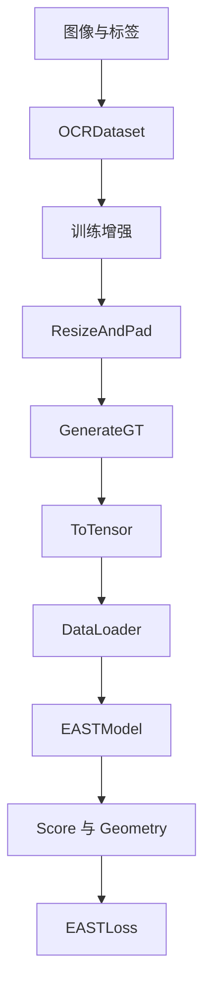
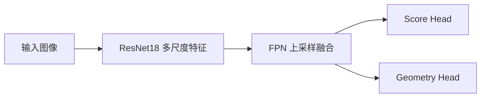
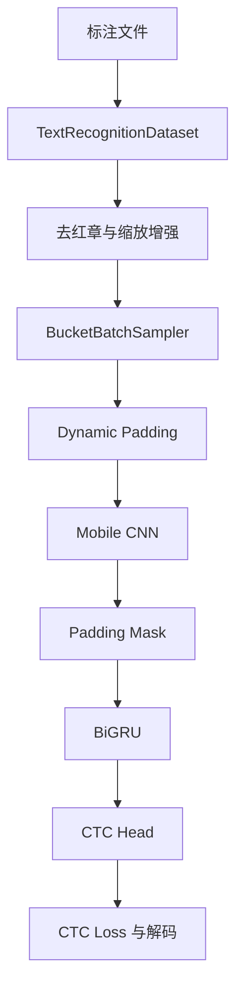
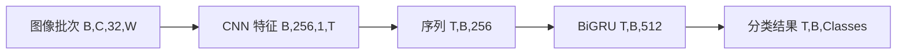

# 检测与识别训练 README 实施计划

> **For agentic workers:** REQUIRED SUB-SKILL: Use superpowers:subagent-driven-development (recommended) or superpowers:executing-plans to implement this plan task-by-task. Steps use checkbox (`- [ ]`) syntax for tracking.

**Goal:** 将 `detection/train_resnet.py` 和 `recognition/train.py` 的实际训练过程整理为结构清晰、包含 Mermaid 图和可执行优化建议的模块 README。

**Architecture:** 两份 README 都采用“入口与依赖 -> 配置 -> 数据契约 -> Mermaid 全流程 -> 分阶段细节 -> 日志与模型保存 -> 风险 -> P0/P1/P2 优化”的统一结构。现状描述严格来源于当前源码，优化建议独立成章，不修改任何训练代码。

**Tech Stack:** Markdown、Mermaid、Python 3、PyTorch、TensorBoard、EAST、CRNN、CTC

## Global Constraints

- 所有文档使用中文。
- 只修改 `detection/README.md`、`recognition/README.md` 和本实施计划。
- 不修改训练脚本、超参数、数据、模型或 checkpoint。
- 不运行完整训练任务。
- 不执行任何形式的 `git push`。
- Mermaid 节点文本避免使用难以解析的特殊符号，复杂说明放在图外。
- 当前流程、风险和优化建议必须明确分隔。

---

### Task 1: 梳理 Detection 训练流程

**Files:**
- Modify: `detection/README.md`
- Reference: `detection/train_resnet.py`
- Reference: `detection/components/dataset.py`
- Reference: `detection/components/transforms.py`
- Reference: `detection/components/ground_truth.py`
- Reference: `detection/components/loss.py`
- Reference: `detection/models/east_model.py`

**Interfaces:**
- Consumes: `OCRDataset` 返回的 `image`、`score_map`、`geo_map`，`EASTModel.forward()` 的 score/geometry 输出，以及 `EASTLoss.forward()` 的总损失、分类损失、几何损失。
- Produces: 能够独立解释检测训练数据流、张量契约、训练循环、验证、早停、保存和优化路线的 README。

- [x] **Step 1: 写入入口、依赖和配置说明**

文档必须包含：

- `python detection/train_resnet.py` 启动方式，并注明需要先激活虚拟环境和确认数据目录。
- ResNet18 + FPN 风格 EAST 模型定位。
- 训练脚本直接依赖表。
- 当前常量配置表：路径、`INPUT_SIZE=640`、`BATCH_SIZE=4`、`EPOCHS=620`、`LEARNING_RATE=1e-4`、验证频率、早停参数和保存数量。
- 数据目录、`gt_<stem>.txt` 标签映射和 `x_min y_min x_max y_max [text]` 解析规则。

- [x] **Step 2: 写入数据、模型和损失流程**

至少包含两个 Mermaid 图：





正文解释 `[B,3,640,640] -> [B,1,160,160] + [B,4,160,160]`，ground truth 收缩、`log1p`、正样本 mask、Dice Loss 和 masked Smooth L1。

- [x] **Step 3: 写入训练、验证、保存和日志细节**

按实际语句顺序解释：清零梯度、前向、损失、反向、每 100 batch 梯度直方图、裁剪到 5、Adam、OneCycleLR、batch/epoch TensorBoard。增加验证与保存 Mermaid 图，体现 50 epoch 前每 10 epoch 验证、之后每 epoch 验证、Top-3、早停和最近 100 个常规 checkpoint。

- [x] **Step 4: 写入风险和可执行优化方案**

风险至少覆盖 geometry 非负性与 `log1p` 契约、无验证集摘要、不可完整恢复 checkpoint、重启后历史常规模型清理、裁剪边界质量和只按 val loss 选模型。

优化表每项包含优先级、问题、修改位置、做法、验证指标和收益。P0 覆盖契约统一、异常/非有限损失、无验证集路径和完整断点；P1 覆盖检测指标、测试、随机种子、AMP、日志开销；P2 覆盖分阶段训练、损失/增强消融和难例采样。

- [x] **Step 5: 检查 Detection README**

Run: `rg -n "train_resnet.py|flowchart|OCRDataset|GenerateGT|EASTModel|EASTLoss|OneCycleLR|EarlyStopping|P0|geometry|checkpoint" detection/README.md`

Expected: 所有关键流程和优化章节均至少匹配一次。

### Task 2: 梳理 Recognition 训练流程

**Files:**
- Modify: `recognition/README.md`
- Reference: `recognition/train.py`
- Reference: `recognition/components/dataset.py`
- Reference: `recognition/components/converter.py`
- Reference: `recognition/models/model.py`
- Reference: `recognition/keys.txt`

**Interfaces:**
- Consumes: `create_dataloader()` 返回的动态图像批次、标签和有效宽度，`LabelConverter` 的编码/解码契约，以及 `CRNN.forward()` 的 `[T,B,C]` log-probability。
- Produces: 能够独立解释识别训练数据流、动态宽度、CTC、指标、调度、保存和优化路线的 README。

- [x] **Step 1: 写入入口、依赖和配置说明**

文档必须包含：

- `python recognition/train.py` 启动方式，并注明需要先激活虚拟环境和确认标注及字典。
- Mobile CNN + BiGRU + CTC 模型定位。
- 训练脚本直接依赖表。
- 当前常量配置表：标注、字典、checkpoint、`IMG_HEIGHT=32`、`IMG_WIDTH=1800` 兼容参数、`BATCH_SIZE=64`、`EPOCHS=680`、`LEARNING_RATE=3e-4`、保存与验证策略。
- 标注解析、`keys.txt` 的 blank/UNK/字符索引规则。

- [x] **Step 2: 写入数据、模型和 CTC 流程**

至少包含两个 Mermaid 图：





正文解释 bucket sampling、批内宽度补齐到 8 的倍数、有效宽度、输出 mask、LabelConverter 和 CTC input/target length。

- [x] **Step 3: 写入训练、验证、调度、保存和日志细节**

按实际顺序解释前向、编码、CTC、反向、梯度裁剪到 2、每 50 step 梯度统计、AdamW、验证 Accuracy/CER/Loss、ReduceLROnPlateau 使用 CER、50 epoch 后周期保存和 Top-3。增加指标与保存 Mermaid 图。

- [x] **Step 4: 写入风险和可执行优化方案**

风险至少覆盖训练/验证标注相同、`img_widths // 4` 与精确宽度计算、非有限 loss 检查时机、坏图 dummy、`IMG_WIDTH` 实际未限宽、注释指标名不一致和不可完整恢复 checkpoint。

优化表每项包含优先级、问题、修改位置、做法、验证指标和收益。P0 覆盖独立验证集、序列长度统一、非有限 loss、坏图隔离、完整断点；P1 覆盖标签审计、分桶增强、随机种子、AMP 和分层 CER；P2 覆盖增强消融、难例采样、解码和模型容量实验。

- [x] **Step 5: 检查 Recognition README**

Run: `rg -n "train.py|flowchart|TextRecognitionDataset|BucketBatchSampler|dynamic_padding|LabelConverter|CRNN|CTCLoss|CER|ReduceLROnPlateau|P0|checkpoint" recognition/README.md`

Expected: 所有关键流程和优化章节均至少匹配一次。

### Task 3: 验证文档一致性

**Files:**
- Verify: `detection/README.md`
- Verify: `recognition/README.md`
- Modify: `docs/superpowers/plans/2026-07-10-training-readmes.md`

**Interfaces:**
- Consumes: 两份完整 README 和设计说明。
- Produces: 路径、符号、Mermaid 和优化边界均通过检查的最终文档。

- [x] **Step 1: 检查 Mermaid 块**

Run: `rg -n '^```mermaid$|^flowchart (TD|LR)$|^```$' detection/README.md recognition/README.md`

Expected: 每份 README 至少有 3 个 Mermaid 块，每个块包含一个 `flowchart` 声明并正确闭合。

- [x] **Step 2: 检查引用符号存在**

Run: `rg -n "class OCRDataset|class EASTModel|class EASTLoss|class EarlyStopping|class TextRecognitionDataset|class BucketBatchSampler|class LabelConverter|class CRNN|def create_dataloader" detection recognition`

Expected: README 描述的核心类和函数均能在源码中找到。

- [x] **Step 3: 检查文档边界和格式**

Run: `rg -n "已知风险|优化方案|尚未实现|建议" detection/README.md recognition/README.md`

Expected: 两份 README 都明确分隔当前风险与建议。

Run: `rg -n "TBD|TODO|待补充|稍后实现" detection/README.md recognition/README.md`

Expected: 无输出。

Run: `git diff --check -- detection/README.md recognition/README.md docs/superpowers/plans/2026-07-10-training-readmes.md`

Expected: 无输出，退出码为 0。

- [x] **Step 4: 标记计划完成并检查状态**

将本计划全部复选框改为 `[x]`，然后运行：

Run: `git status --short`

Expected: 只有两个 README 和本实施计划属于本任务范围；不执行 `git push`。
