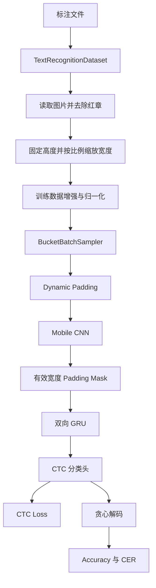
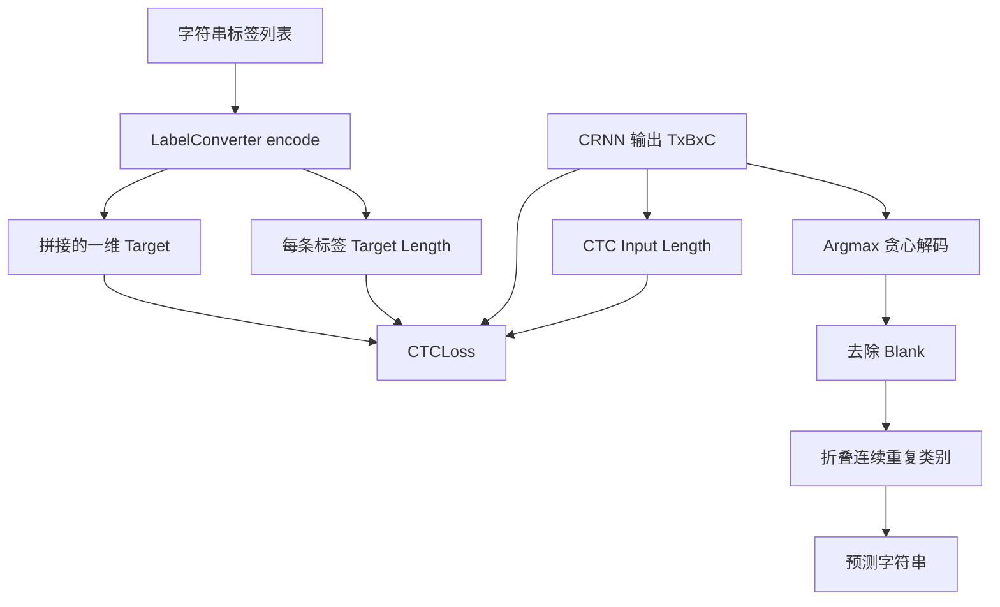
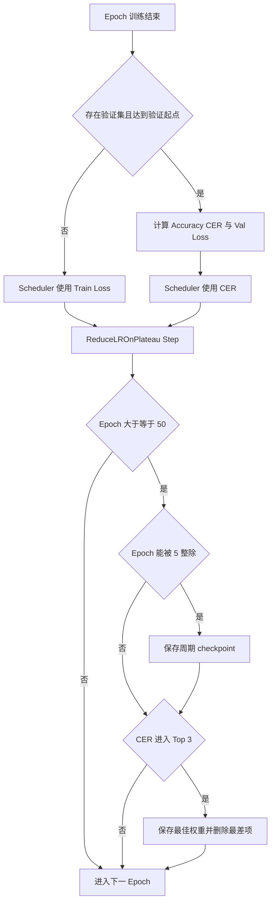

# Recognition 文本识别训练流程

本文档依据当前代码梳理 `recognition/train.py` 的实际训练过程，覆盖标注与字典、图像预处理、动态宽度 batch、CRNN 前向传播、CTC Loss、验证指标、学习率调度、TensorBoard 和 checkpoint 管理。文末的优化方案是后续建议，**尚未在当前训练代码中实现**。

## 1. 训练目标与代码入口

训练目标是将已裁剪的文本行图片识别为字符序列。当前网络由三部分组成：

1. MobileNet 风格的轻量 CNN，将高度 32 的图片压缩为高度 1 的序列特征。
2. 单层双向 GRU，在宽度方向建模上下文。
3. 线性分类头和 CTC，对每个时间步输出字符类别的 log probability。

主要入口和直接依赖如下。

| 文件 | 作用 |
| --- | --- |
| `recognition/train.py` | 训练主循环、验证、CER/Accuracy、调度、日志和模型保存 |
| `recognition/components/dataset.py` | 标注读取、图片预处理、bucket sampling、动态 padding |
| `recognition/components/converter.py` | 字符字典加载、标签编码和 CTC 贪心解码 |
| `recognition/models/model.py` | Mobile CNN、padding mask、BiGRU 和分类头 |
| `recognition/keys.txt` | 字符集合及类别顺序 |

从仓库根目录运行，且必须先激活项目虚拟环境：

```bash
source .venv/bin/activate
python recognition/train.py
```

训练前应确认训练标注、独立验证标注、图片路径和 `keys.txt` 都有效。当前入口不会在启动时统一执行这些检查，部分缺失问题只会在数据加载或迭代时暴露。

## 2. 当前训练配置

训练参数全部定义在 `recognition/train.py` 顶部，不使用命令行参数。

| 配置 | 当前值 | 作用 |
| --- | ---: | --- |
| `TRAIN_ANNOTATION` | `recognition/data/train_annotation.txt` | 训练标注 |
| `VALID_ANNOTATION` | `recognition/data/train_annotation.txt` | 当前验证标注；与训练标注相同 |
| `KEYS_PATH` | `recognition/keys.txt` | 字符字典 |
| `CHECKPOINT_DIR` | `recognition/checkpoints/` | 模型保存目录 |
| `IMG_HEIGHT` | `32` | 模型要求的固定输入高度 |
| `IMG_WIDTH` | `1800` | 兼容参数；当前数据集实际不按此值截断或 padding |
| `NUM_CHANNELS` | `1` | 灰度输入 |
| `BATCH_SIZE` | `64` | 每个 batch 的样本数 |
| `EPOCHS` | `680` | 最大训练轮数 |
| `LEARNING_RATE` | `3e-4` | AdamW 初始学习率 |
| `NUM_WORKERS` | `4` | DataLoader worker 数 |
| `SAVE_INTERVAL` | `5` | 开始保存后，每 5 epoch 保存周期备份 |
| `START_VALID_EPOCH` | `1` | 从第一轮开始验证 |
| `START_SAVE_EPOCH` | `50` | 从第 50 轮开始保存模型 |
| `KEEP_TOP_K` | `3` | 按验证 CER 保留的最佳模型数 |
| `DEVICE` | CUDA 可用时用 CUDA，否则 CPU | 训练设备 |

优化器与调度器：

- 优化器：`AdamW(model.parameters(), lr=3e-4, weight_decay=1e-4)`。
- 损失：`CTCLoss(blank=0, zero_infinity=True)`。
- 调度器：`ReduceLROnPlateau(mode='min', factor=0.8, patience=20, min_lr=1e-6)`。
- 有验证集时调度指标是 CER；没有验证集时退化为训练平均 loss。
- 梯度裁剪：全模型梯度 L2 范数最大为 `2.0`。

## 3. 标注与字符字典

### 3.1 标注文件

`TextRecognitionDataset` 逐行读取标注，按英文逗号切分：

```text
relative/or/absolute/image_path,"文本标签"
```

解析规则：

1. 第一段是图片路径。
2. 第二段及之后重新用英文逗号拼接为标签，因此被引号包裹的标签可以包含英文逗号。
3. 标签中的所有双引号都会被移除。
4. 相对图片路径以标注文件所在目录为基准拼接。
5. 少于两段的行会被静默跳过。

例如标注文件位于 `recognition/data/train_annotation.txt`：

```text
train_images/sample.png,"示例,文本"
```

会解析为：

```text
图片: recognition/data/train_images/sample.png
标签: 示例,文本
```

### 3.2 keys.txt 类别映射

`LabelConverter` 按 `keys.txt` 的行顺序构造类别：

| 索引 | 含义 |
| ---: | --- |
| `0` | `[blank]`，CTC 空白类别 |
| `1` | `[UNK]`，字典外字符 |
| `2...` | `keys.txt` 中按行排列的字符 |

关键约束：

- `keys.txt` 的字符顺序决定模型分类头语义，不能随意排序或重排。
- 文件读取只去掉换行符，单独一行的空格字符会被保留。
- 编码时未知字符映射到 `[UNK]`，并打印当前 batch 的未知字符警告。
- `num_classes` 决定 `CRNN` 最后线性层的输出维度。
- 修改字典后，旧 checkpoint 的分类头和类别含义通常不再兼容。

## 4. 端到端训练数据流



### 4.1 图片读取与去红章

`BaseTextDataset._load_and_process_image()` 执行：

1. 用 PIL 读取并统一转换为 RGB。
2. `remove_red_seal()` 在 HSV 空间检测红色区域。
3. 对红色 mask 做膨胀和闭运算，再用白色替换。
4. `NUM_CHANNELS=1` 时转为灰度图。

去红章同时应用于训练、验证和推理数据，因为它位于公共的图片读取流程中。

### 4.2 固定高度与动态宽度

图片目标高度固定为 32，基础宽度按原始宽高比计算：

```text
scale = 32 / original_height
new_width = int(original_width * scale)
```

随后应用两层保护：

1. 高图宽度保护
   - 如果按高度缩放后的宽度小于原始宽度的 50%，将宽度提高到 `min(original_width * 0.5, 800)`。
   - 高度仍固定为 32，因此该保护可能改变原始宽高比。
2. 最小宽度保护
   - 如果宽度小于 48，不继续拉伸文本。
   - 将图片水平居中粘贴到宽度 48 的白色画布上。

`IMG_WIDTH=1800` 只作为函数兼容参数传入；当前 `TextRecognitionDataset` 不使用它限制最大宽度。

### 4.3 训练与验证增强

| 阶段 | 变换顺序 |
| --- | --- |
| 训练 | 轻微旋转 -> 随机透视 -> ColorJitter -> ToTensor -> 随机高斯模糊 -> 随机高斯噪声 -> RandomErasing -> Normalize |
| 验证/推理 | ToTensor -> Normalize |

训练增强参数：

- 旋转角度：`[-2, 2]`，空白区域填白色。
- 随机透视：`distortion_scale=0.1`、`p=0.3`。
- ColorJitter：亮度/对比度 `0.2`，饱和度 `0.1`。
- 高斯模糊：`p=0.3`。
- 高斯噪声：标准差 `0.02`，`p=0.3`。
- 随机擦除：`p=0.18`，面积比例 `[0.02, 0.1]`。
- 归一化：`mean=0.5`、`std=0.5`，白色像素映射为 `1.0`。

### 4.4 Bucket Sampling 与 Dynamic Padding

训练集初始化时，`BucketBatchSampler` 会预扫描全部图片的宽高比：

1. 按宽高比从小到大排序样本索引。
2. 将相邻且宽高比相近的样本组成 batch。
3. 只打乱 batch 的顺序，不打乱 batch 内样本顺序。
4. `drop_last=False`，保留最后一个不满 batch。

验证集不使用 bucket sampler，只按标注顺序组成普通 batch。

`dynamic_padding_collate_fn()` 对每个 batch：

1. 记录每张图片 padding 前的真实宽度 `img_widths`。
2. 找到当前 batch 最大宽度。
3. 将最大宽度向上补齐到 8 的倍数。
4. 创建值为 `1.0` 的白色背景张量。
5. 将每张图片左对齐写入画布。

输出契约：

| 输出 | 形状 | 含义 |
| --- | --- | --- |
| `padded_imgs` | `[B,C,32,Wmax]` | 批内动态 padding 后的图片 |
| `labels` | 长度为 B 的 tuple | 原始字符串标签 |
| `img_widths` | `[B]` | 每张图 padding 前的真实像素宽度 |

+## 5. 模型结构与张量形状


宽度和高度下采样：

- 输入高度固定为 32。
- Stem 在高宽方向都下采样 2 倍。
- MaxPool 再在高宽方向下采样 2 倍。
- 三个主 block 只继续压缩高度，宽度 stride 为 1。
- 最终高度为 1，宽度时间步大约是输入有效宽度的 1/4。

典型张量变化：

```text
[B,1,32,Wmax]
-> [B,256,1,T]
-> [T,B,256]
-> [T,B,512]
-> [T,B,num_classes]
```

### 5.1 有效宽度 Mask

`CRNN.forward(input, img_widths)` 通过 `_calc_cnn_output_width()` 精确计算每张图片的有效时间步：

1. 根据 Stem 卷积公式计算一次宽度。
2. 根据 MaxPool 公式再计算一次宽度。
3. 将结果限制到 `[1, batch_seq_len]`。
4. 在 GRU 前把 padding 时间步的 CNN 特征置 0。
5. 在分类头后将 padding 位置设置为 blank 概率最高。

该 mask 避免反向 GRU 从右侧 padding 区域传播无效特征，并使贪心解码忽略 padding。

## 6. 标签编码与 CTC Loss



当前训练脚本使用：

```text
preds_size = (img_widths // 4).clamp(min=1)
```

作为每个样本的 CTC input length；target length 由每条原始标签的字符数给出。`CTCLoss` 使用 `zero_infinity=True`，当输入时间步不足导致无限损失时会将该损失及梯度置零。

贪心解码过程：

1. 对每个时间步取最大概率类别。
2. 移除 blank 类别 0。
3. 折叠连续相同类别。
4. 用 `idx2char` 还原字符串。

## 7. 初始化训练对象

`train()` 的初始化顺序：

1. 打印 CPU/CUDA 设备。
2. 创建 `recognition/checkpoints/`。
3. 创建 TensorBoard Writer。
4. 用 `keys.txt` 初始化 `LabelConverter` 和 `num_classes`。
5. 创建 `CRNN(img_height=32, nc=1, n_class=num_classes)`。
6. 创建 `CTCLoss(blank=0, zero_infinity=True)`。
7. 创建 AdamW 和 ReduceLROnPlateau。
8. 创建训练 DataLoader。
9. 如果验证标注存在，创建验证 DataLoader。
10. 初始化 `global_step=0` 和进程内 Top-K 列表。

## 8. 单个 Epoch 的训练过程

每个 epoch 执行以下顺序：

1. `model.train()`，清空 epoch loss 和有效 batch 计数。
2. 读取 `(images, labels, img_widths)` 并将图片、宽度移到设备。
3. `model(images, img_widths=img_widths)` 得到 `[T,B,C]` 的 log probability。
4. `converter.encode(labels)` 得到拼接 target 和 target length。
5. 使用 `img_widths // 4` 得到 CTC input length。
6. 计算 CTC Loss。
7. `optimizer.zero_grad()` 清空梯度。
8. `loss.backward()` 反向传播。
9. `clip_grad_norm_(..., max_norm=2.0)` 裁剪梯度。
10. 每 50 个 global step 记录总梯度 L2 范数和最大绝对梯度。
11. `optimizer.step()` 更新参数。
12. 只有 loss 为有限值时，才累计 epoch loss、更新进度条并写入 batch loss。
13. `global_step` 加 1。
14. epoch 结束后计算有限 loss batch 的平均值并写入 TensorBoard。

注意：有限性检查发生在反向传播和参数更新之后，因此当前逻辑不能阻止 NaN/Inf 污染模型。

## 9. 验证指标

`evaluate()` 使用 `model.eval()` 和 `torch.no_grad()`，计算三类指标。

### 9.1 Validation Loss

验证 CTC Loss 的计算与训练相同。只有有限 loss 才加入平均值；如果没有任何有限 batch，返回 `inf`。

### 9.2 Accuracy

预测和标签都执行 `strip()`，完全一致才算正确：

```text
accuracy = 完全匹配样本数 / 总样本数
```

这是一项严格的整行文本准确率。

### 9.3 CER

每个预测与真值使用 Levenshtein 编辑距离：

```text
CER = 所有样本编辑距离总和 / 所有真值字符数
```

真值字符总数为 0 时，CER 返回 1.0。

## 10. 学习率调度与模型保存



### 10.1 ReduceLROnPlateau

- 有验证集时使用 `val_cer`。
- 没有验证集时使用 `train_avg_loss`。
- 指标连续 20 次没有改善后，学习率乘以 0.8。
- 最低学习率为 `1e-6`。

### 10.2 周期 checkpoint

从 epoch 50 开始，每 5 个 epoch 保存：

```text
recognition/checkpoints/epoch_<epoch>.pth
```

脚本没有周期 checkpoint 数量上限，也不会自动清理这些备份。

### 10.3 Top-K 最佳模型

有验证集时，以 scheduler 使用的指标作为 Top-K 指标；当前实际为 CER。保存名称：

```text
recognition/checkpoints/<timestamp>best_cer_<cer>_epoch_<epoch>.pth
```

进程内列表按 CER 从小到大排序，只保留 3 个；超出后删除当前列表中 CER 最大的文件。列表不会从磁盘恢复，因此重启训练后会重新建立一组 Top-K。

所有 checkpoint 都只保存 `model.state_dict()`，不含 optimizer、scheduler、epoch、随机数状态或最佳模型列表。

+## 11. TensorBoard 观察点

日志目录：

```text
recognition/runs/ocr_exp_<timestamp>
```

启动查看：

```bash
tensorboard --logdir=recognition/runs
```

当前记录：

- `Train/Batch_Loss`
- `Train/Epoch_Loss`
- `Validation/Accuracy`
- `Validation/CER`
- `Validation/Loss`
- `Grad/Total_L2_Norm`
- `Grad/Max_Abs_Grad`

建议同时观察 CER、整行 Accuracy 和 CTC Loss。CER 下降但 Accuracy 不变时，通常表示预测字符更接近真值，但仍存在少量字符错误；Loss 下降而 CER 变差时，应优先排查数据划分、长度计算和解码契约。

## 12. 当前已知风险

以下是源码现状，不表示问题已经修复。

| 风险 | 当前行为 | 影响 |
| --- | --- | --- |
| 训练与验证数据泄漏 | `TRAIN_ANNOTATION` 和 `VALID_ANNOTATION` 指向同一文件 | 验证 CER/Accuracy 不能代表泛化能力；且同一图片在训练和验证使用不同增强 |
| CTC 长度公式不完全统一 | train/evaluate 使用 `img_widths // 4`，模型 mask 使用 `_calc_cnn_output_width()` | 某些宽度余数下可能少算有效时间步，影响长标签 loss |
| 非有限 loss 检查太晚 | `backward()` 和 `optimizer.step()` 后才检查 | NaN/Inf 可能已污染参数和优化器状态 |
| 坏图返回 dummy | 图片读取异常时返回 `[C,32,8]` 全 1 张量，但保留原标签 | 无效图片与长标签组合可能产生零 loss 或错误监督 |
| `IMG_WIDTH` 未实际限宽 | 参数只为兼容保留 | 极宽图片可能导致显存峰值或 OOM |
| 宽度保护可能改变比例 | 高图保护直接提高宽度但高度固定 32 | 字符形态可能被水平拉伸 |
| 指标注释与实际行为不一致 | 注释称 Valid Loss，Top-K 实际使用 CER | 维护者可能错误理解 scheduler 和模型选择标准 |
| Checkpoint 不可完整恢复 | 只保存模型权重 | 无法恢复 AdamW 动量、学习率状态、epoch 和 Top-K |
| 周期模型不清理 | 每 5 epoch 持续新增文件 | 长训练会持续占用磁盘 |
| Top-K 只覆盖本次进程 | 启动时 `best_checkpoints=[]` | 恢复训练可能产生超过 3 个历史最佳模型 |
| 数据集静默跳过坏标注行 | 少于两段的标注不报告 | 数据量可能低于预期且难以定位 |
| 空标签和字典重复缺少审计 | 启动前没有集中检查 | CTC target、类别数和评估分母可能异常 |

## 13. 训练流程优化方案

以下方案均为建议，尚未实现。优先处理 P0，再用真正独立的验证集做 P1/P2 对照实验。

| 优先级 | 问题与修改位置 | 建议做法 | 验证指标 | 预期收益 |
| --- | --- | --- | --- | --- |
| P0 | `train.py` 训练/验证标注相同 | 按文档来源、模板或时间分组切分独立验证集；对近重复图片做哈希去重；启动时拒绝完全相同的路径 | 训练/验证交集为 0、近重复率、独立 CER/Accuracy | 获得可信泛化指标 |
| P0 | CTC 有效长度在 `train.py` 与 `model.py` 重复计算 | 暴露统一的向量化宽度计算函数，训练、验证、mask 和导出共用；为宽度模 4 的所有情况建立测试 | 每种宽度的 CNN 实际 T 与计算值一致、CTC 非零有效率 | 消除长度少算和契约漂移 |
| P0 | 非有限 loss 在更新后才检查 | 在 `backward()` 前检查 loss；异常时记录图片路径、标签长度、输入宽度、T 和 target length，并跳过 batch；设置连续异常上限 | 非有限 batch 数、参数有限性、异常样本可追踪率 | 防止训练状态被污染 |
| P0 | 坏图变为 dummy 样本 | 数据预扫描时隔离坏图；`__getitem__` 返回错误应由可追踪策略处理，不把原标签配给 dummy；输出坏样本清单 | 坏图清单、有效样本数、无 dummy 参与训练 | 避免静默错误监督 |
| P0 | checkpoint 只有权重 | 保存 epoch、model、optimizer、scheduler、global step、Top-K、随机数状态、字典哈希和配置；加载时校验字典及模型结构 | 中断恢复后学习率、下一 batch loss 和 CER 连续 | 支持可靠断点续训 |
| P0 | 极宽样本无上限 | 统计宽度与标签长度分布，根据显存设最大像素宽度；超限样本使用可解释的缩放、切分或单独 batch 策略 | OOM 次数、峰值显存、长文本 CER | 控制显存并保留长文本能力 |
| P1 | 标注和字典缺少启动审计 | 检查文件存在、重复路径、空标签、未知字符、重复 key、字符覆盖率、CTC 可行性 `T >= target length` | 未知字符率、无效样本数、字典覆盖率 | 在长训练前发现数据问题 |
| P1 | Bucket 只按图片宽高比 | 结合预处理后宽度和标签长度分桶；设置最大 batch 像素数，让超长样本自动使用更小 batch | padding 比例、图片每秒、峰值显存 | 提升吞吐并降低 OOM 风险 |
| P1 | 实验不可完全复现 | 固定 Python、NumPy、Torch、worker 随机种子；记录依赖、GPU、配置、数据和字典哈希 | 同配置多次 CER 方差 | 可靠比较优化效果 |
| P1 | FP32 显存和吞吐成本 | 在 CTC 数值检查通过后引入 AMP/GradScaler；保留 loss 和 log_softmax 的稳定路径 | 图片每秒、峰值显存、CER 差异、非有限 loss 数 | 提升吞吐或支持更长宽度 |
| P1 | 指标只有总体均值 | 按标签长度、图片宽度、字符类型、未知字符、印章和模糊程度统计 CER/Accuracy | 分层 CER、长文本 CER、总体 CER | 定位真实失败场景 |
| P1 | 周期 checkpoint 无限增长 | 引入最近 N 个周期模型保留策略，同时从磁盘恢复 Top-K 索引 | checkpoint 数量、磁盘占用、恢复正确性 | 控制存储并保持可恢复性 |
| P2 | 增强组合未做消融 | 分别关闭去红章、透视、模糊、噪声和擦除，保持其他条件相同；按场景比较 | 总体及分层 CER、Accuracy | 识别有害或无效增强 |
| P2 | 难例在普通采样中稀释 | 按历史 CER、标签长度、罕见字符和低质量图建立难例池，限制采样上限防止过拟合 | 难例 CER、总体 CER、类别覆盖率 | 提升关键长尾样本表现 |
| P2 | 仅使用贪心解码 | 在不改变训练的前提下比较 beam search、字符约束或轻量语言模型，并保留无约束基线 | CER、Accuracy、解码延迟 | 降低可由上下文纠正的错误 |
| P2 | 模型容量和正则参数依赖经验 | 对 GRU hidden、层数、dropout 和 CNN 通道做单变量实验，报告参数量和 CPU 延迟 | CER、Accuracy、参数量、推理延迟 | 找到精度与部署成本平衡 |

## 14. 推荐实施顺序与验收

1. 生成真正独立且无近重复的验证集，记录当前代码基线。
2. 完成统一序列长度、非有限 loss 保护、坏图隔离和完整 checkpoint。
3. 增加数据/字典审计和分层 CER，确保每次训练输入可解释。
4. 在相同数据、字典和随机种子下评估 AMP、bucket 优化和 checkpoint 策略。
5. 最后进行增强、难例、解码和模型容量实验，每次只改变一个主变量。

最低验收标准：

- 训练集与验证集无路径和近重复泄漏。
- 所有样本的有效时间步与 CNN 实际输出一致。
- 训练 loss 和参数全程有限，坏图及未知字符有清单。
- 中断恢复后的学习率、global step 和指标连续。
- 优化版本在独立验证集上不降低总体 CER，并报告长文本 CER、Accuracy、吞吐和显存变化。
